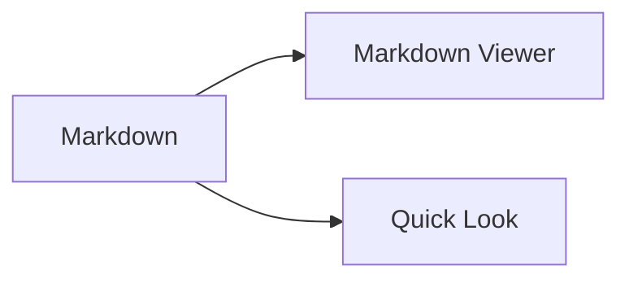

# Markdown Viewer

Нативный просмотрщик локальных документов Markdown и AsciiDoc для macOS 13 и новее. Использует AppKit, WebKit, системный парсер Markdown в Foundation и Asciidoctor.js. Mermaid и Asciidoctor.js входят в сборку. Устанавливать пакеты для сборки или запуска не требуется.

## Сборка и запуск

Нужны Xcode Command Line Tools с компилятором Swift и SDK macOS 13 или новее. Скрипт собирает и подписывает приложение для архитектуры компьютера, на котором выполняется.

```bash
./Scripts/build.sh
open ".build/Markdown Viewer.app"
```

Можно открыть конкретный файл из терминала.

```bash
open -a "$PWD/.build/Markdown Viewer.app" README.md
```

## Быстрый просмотр в Finder

Откройте собранное приложение один раз, чтобы macOS зарегистрировала расширение. Затем выделите в Finder файл Markdown или AsciiDoc и нажмите пробел. Если macOS использует другой обработчик, проверьте, что расширение Markdown Viewer включено в разделе расширений быстрого просмотра в системных настройках.

Разведите два пальца на трекпаде, чтобы увеличить документ в Быстром просмотре или в окне приложения. Сведите пальцы, чтобы уменьшить масштаб.

## Использование

- Открывайте `.md`, `.markdown` и `.mdown` через **Файл → Открыть** (⌘O), перетаскивайте их в окно или используйте «Открыть с помощью» в Finder.
- Файлы AsciiDoc (`.adoc`, `.asciidoc`, `.asc` и `.ad`) открываются теми же способами.
- Нажмите ⌘F для поиска, ⌘G для следующего совпадения и ⇧⌘G для предыдущего. Нажмите ⌘R, чтобы перечитать файл после изменения.
- Просмотрщик поддерживает заголовки и ссылки на них, списки, цитаты, таблицы, блоки кода и локальные изображения PNG, JPEG, GIF и WebP в папке документа и её подпапках. Тема следует настройкам macOS.
- Документы открываются в режиме чтения. Поддерживаются ASCII, UTF-8 и UTF-16 с BOM, до 16 МБ на документ. Встроенный HTML отображается как текст, для сетевых изображений показывается текстовое описание. Веб-ссылки открываются в браузере.

Интерфейс следует языку приложения в macOS. Доступны английский и русский. Для остальных языков используется английский.

### AsciiDoc

Приложение и Quick Look отображают форматированный HTML с оглавлением, перекрёстными ссылками, сносками, таблицами, блоками кода и примечаниями. В окне приложения локальные изображения, включая SVG, и директивы `include::` загружаются из папки документа и её подпапок. В Quick Look доступ к соседним файлам зависит от разрешений, которые Finder передаёт расширению. Просмотр работает офлайн, без загрузки сетевых ресурсов и запуска сторонних расширений Asciidoctor.

Для ручной проверки откройте AsciiDoc-файл с оглавлением, таблицей и локальным изображением в приложении. Затем выделите тот же файл в Finder и нажмите пробел. Проверьте заголовки, данные таблицы и переходы по оглавлению.

### Диаграммы и списки задач

Для Mermaid используйте блок кода с меткой `mermaid`. В окне приложения и в Быстром просмотре блок-схемы, диаграммы последовательности, классов и другие поддерживаемые Mermaid диаграммы строятся локально. Если диаграмму нельзя построить, показывается её исходный текст.



Маркеры `- [ ]` и `- [x]` в списках отображаются как флажки только для чтения.

### ASCII-схемы

Для сохранения отступов и выравнивания поместите схему в блок кода. Используйте метку `ascii`, если хотите указать формат.

````markdown
```ascii
+--------+     +---------+
|  File  | --> | Preview |
+--------+     +---------+
```
````

## Разработка

Точка входа находится в `Sources/main.swift`. Окно и команды просмотра реализованы в `Sources/ViewerWindow.swift`, разбор вывода Foundation и чтение файлов — в `Sources/MarkdownRenderer.swift` и `Sources/MarkdownDocument.swift`. Страница просмотра общая для окна и Quick Look и собирается в `Sources/PreviewPage.swift`. Расширение Finder находится в `Extensions/QuickLook/`, а оформление, локализации и библиотека Mermaid — в `Resources/`.

```bash
./Scripts/test.sh
```

Тесты из `Tests/` проверяют чтение файлов, структуру Markdown и безопасное отображение ссылок и HTML. Для ручной проверки откройте этот README в приложении и через пробел в Finder. Проверьте, что диаграмма Mermaid отображается и что жест двумя пальцами увеличивает и уменьшает масштаб в обоих режимах.

## Лицензия

[MIT](LICENSE). Лицензии Mermaid и её зависимостей перечислены в [Mermaid-LICENSES.txt](Resources/ThirdParty/Mermaid-LICENSES.txt).
